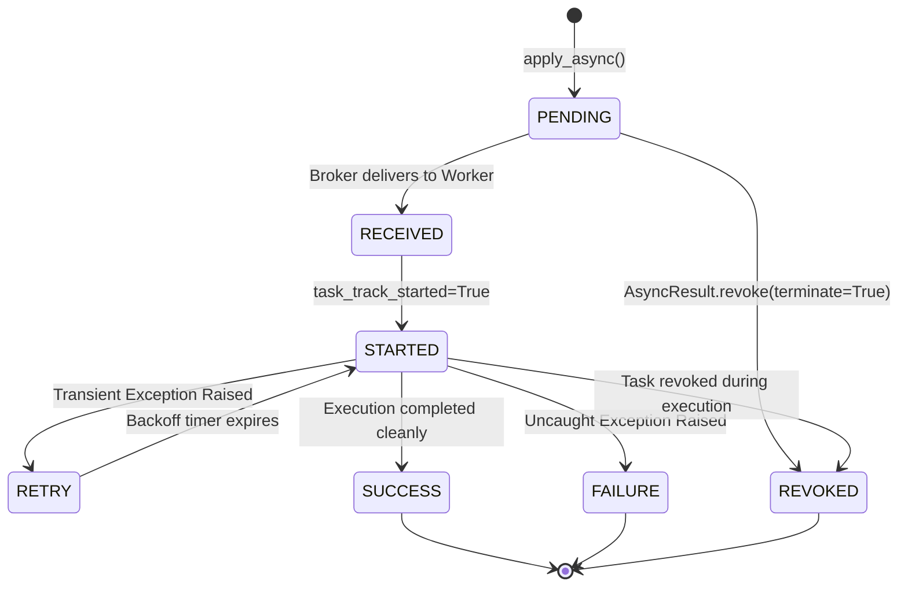

# Day 59: Celery Distributed Task Queue, Workers, Beat Scheduling & Monitoring

An enterprise architectural guide and implementation blueprint for building resilient, horizontally scalable asynchronous task processing systems using **Celery 5.x**, **Redis / RabbitMQ message brokers**, **worker execution pools**, **Celery Beat periodic scheduling**, and **production monitoring**.

---

## 1. Asynchronous Task Processing & The Decoupled Architecture

In modern backend engineering, synchronous HTTP request-response cycles must strictly adhere to sub-100 millisecond response budgets. When an incoming request demands long-running operations—such as PDF generation, machine learning inference, bulk transactional email dispatch, third-party webhook delivery, or high-throughput ETL data normalization—performing these operations within the WSGI/ASGI thread pool leads directly to:

1. **Thread Pool Starvation**: Web server threads (Uvicorn, Gunicorn) become blocked waiting for downstream I/O or heavy CPU computation, causing incoming socket connection queues to overflow with `HTTP 504 Gateway Timeout` errors.
2. **Cascading Service Failures**: Transient downstream outages (e.g., Stripe API latency spikes) propagate upstream, halting user-facing endpoints.
3. **Loss of In-Flight Work**: If a web server container crashes or restarts during an in-memory asynchronous background task (such as FastAPI `BackgroundTasks`), the execution context is destroyed with zero durability or retry capability.

```
+-----------------------------------------------------------------------------------------+
|                                DECOUPLED CELERY TOPOLOGY                                |
+-----------------------------------------------------------------------------------------+
                                                                                         
   [ Client / Browser ]                                                                  
            │                                                                            
            ▼ HTTP POST /api/v1/orders                                                   
   +────────────────────────+                                                            
   | FastAPI / Django App   | ──[ 1. Write DB ]──▶ [( PostgreSQL Cluster )]             
   | (Web Producer)         |                                                            
   +────────────────────────+                                                            
            │                                                                            
            ▼ 2. task.apply_async(args=[order_id], queue="orders")                       
   +─────────────────────────────────────────────────────────────+                       
   |                   MESSAGE BROKER (RabbitMQ / Redis)         |                       
   |  Exchange ──▶ [ Queue: orders ] ──▶ [ Queue: priority ]     |                       
   +─────────────────────────────────────────────────────────────+                       
            │                                     │                                      
      BRPOP / Basic.Consume                 BRPOP / Basic.Consume                        
            │                                     │                                      
            ▼                                     ▼                                      
   +──────────────────────+              +──────────────────────+                        
   | Celery Worker Node A |              | Celery Worker Node B |                        
   |  - Prefork Process 1 |              |  - Prefork Process 1 |                        
   |  - Prefork Process 2 |              |  - Prefork Process 2 |                        
   +──────────────────────+              +──────────────────────+                        
            │                                     │                                      
            ▼ 3. Store AsyncResult                ▼ 3. Store AsyncResult                 
   +─────────────────────────────────────────────────────────────+                       
   |               RESULT BACKEND (Redis / PostgreSQL)           |                       
   |             Key: celery-task-meta-<task_id> (TTL: 1 hour)   |                       
   +─────────────────────────────────────────────────────────────+                       
```

By decoupling task generation (**Producer**) from task execution (**Consumer/Worker**) through an intermediate, persistent **Message Broker**, backend systems achieve:
- **Temporal Decoupling**: Tasks can be queued during peak traffic spikes and processed at a controlled, sustainable rate by workers without dropping traffic.
- **Fault Isolation**: A complete crash of worker nodes does not impact the web API's ability to accept incoming user requests and persist tasks to the broker.
- **Horizontal Elasticity**: Worker pools can scale independently from web API nodes based on queue depth metrics.

---

## 2. Celery 5.x Component Topology

A production Celery ecosystem consists of five distinct architectural components:

| Component | Role | Production Technology Choices |
|---|---|---|
| **Client (Producer)** | Enqueues task messages into the broker using `.delay()` or `.apply_async()`. | FastAPI, Django, Flask, CLI scripts. |
| **Message Broker** | Durable message transport that holds, buffers, and routes task messages. | **RabbitMQ** (Standard enterprise AMQP), **Redis** (In-memory, fast, key-value). |
| **Worker (Consumer)** | Standalone daemon process containing execution pools that dequeue, execute, and acknowledge tasks. | `celery -A proj worker --concurrency=N -P prefork` |
| **Result Backend** | Key-value or relational store recording task execution status, return values, and exceptions. | Redis, Memcached, PostgreSQL/SQLAlchemy, AWS S3. |
| **Celery Beat** | Single-node daemon that reads periodic schedules and dispatches task messages to the broker at scheduled intervals. | `celery -A proj beat -S redbeat.RedBeatScheduler` |

---

## 3. Broker Comparison: RabbitMQ vs. Redis

Choosing the correct message broker dictates system reliability, routing complexity, and operational overhead.

```
+───────────────────────────────+──────────────────────────────────+──────────────────────────────────+
| Feature                       | RabbitMQ (Native AMQP 0-9-1)     | Redis (Key-Value / Streams)      |
+───────────────────────────────+──────────────────────────────────+──────────────────────────────────+
| Architectural Model           | Smart Broker, Dumb Consumer      | Dumb Broker, Smart Consumer      |
| Message Routing               | Exchanges (Direct, Fanout, Topic,| Direct Queue Names (LPUSH/BRPOP) |
|                               | Headers) to Queues via Bindings  | or Redis Streams                 |
| Acknowledgment Model          | Native protocol-level ACK/NACK;  | Visibility timeout simulation;   |
|                               | unacked messages redeliver on drop| unacked messages re-queued after|
|                               |                                  | `visibility_timeout` expires     |
| Persistence & Durability      | Erlang Mnesia + Disk Paging;     | RDB snapshots + AOF log;         |
|                               | guaranteed disk commit semantics | memory pressure can drop keys    |
| Priority Queues               | Native `x-max-priority` support  | Emulated using sorted sets       |
| Production Recommendation     | Mission-critical financial, e-   | High-speed caching, lower devops |
|                               | commerce, and strict SLA queues  | complexity, shared Redis infra   |
+───────────────────────────────+──────────────────────────────────+──────────────────────────────────+
```

### The Redis Visibility Timeout Trap
When using Redis as a broker, Celery relies on `BRPOP` and an auxiliary "unacknowledged" list. Because Redis lacks protocol-level AMQP channel acknowledgments, Celery sets a `visibility_timeout` (default: 3600 seconds). 
> [!WARNING]
> If a long-running task executes longer than `visibility_timeout`, Redis assumes the worker crashed and redelivers the identical task message to another worker while the original worker is still processing it! Always tune `broker_transport_options = {'visibility_timeout': 86400}` if tasks can span hours.

---

## 4. Worker Execution Pool Architecture

Celery decouples task execution from the OS process model using **Execution Pools**. Selecting the wrong pool is the number one cause of memory bloat, thread contention, and worker hangs.

```
       [ Master Celery Daemon Process ]
                      │
     ┌────────────────┼────────────────┐
     ▼                ▼                ▼
[ Pool: prefork ] [ Pool: threads ] [ Pool: gevent ]
 (CPU-Bound / DB)  (I/O-Bound Net)   (Massive I/O)
  fork() child 1    OS Thread 1       Greenlet 1
  fork() child 2    OS Thread 2       Greenlet 2
  fork() child N    OS Thread N       Greenlet 1000+
```

1. **Prefork Pool (`-P prefork`)**:
   - **Mechanism**: The master process calls POSIX `fork()` to spawn $N$ child processes (default: number of CPU cores).
   - **GIL Behavior**: Bypasses Python's Global Interpreter Lock (GIL) completely; each worker is an independent Python process with dedicated memory and interpreter state.
   - **Use Cases**: Heavy CPU calculation, NumPy/Pandas processing, cryptographic hashing, and standard SQLAlchemy/Django database operations.
   - **Memory Warning**: Copy-On-Write (COW) memory degradation occurs over time. Configure `worker_max_tasks_per_child=1000` to periodically recycle child processes and prevent memory leaks.

2. **Threads Pool (`-P threads`)**:
   - **Mechanism**: Spawns multiple native OS threads within a single Python process.
   - **GIL Behavior**: Constrained by the GIL. Only one thread executes Python bytecode at any instant.
   - **Use Cases**: Light I/O-bound tasks where thread creation is cheaper than process forking.

3. **Eventlet / Gevent Pool (`-P gevent` / `-P eventlet`)**:
   - **Mechanism**: Uses non-blocking cooperative greenlets via `monkey.patch_all()`.
   - **GIL Behavior**: Runs on a single OS thread, interleaving thousands of greenlets when I/O waits occur (`asyncio`-like cooperative concurrency).
   - **Use Cases**: High-concurrency network tasks: scraping 5,000 URLs concurrently, dispatching thousands of Webhooks, or interacting with rate-limited APIs.
   - **Caution**: C-extensions that do not yield control or standard blocking socket calls without monkey-patching will freeze the entire worker.

4. **Solo Pool (`-P solo`)**:
   - **Mechanism**: Runs inside the main process without subprocesses or threads.
   - **Use Cases**: Debugging with `pdb`, local development, or memory-constrained micro-containers.

---

## 5. Prefetch Count, QoS & Task Starvation

A Celery worker maintains an internal buffer of tasks called the **prefetch buffer**. The number of unacknowledged messages a worker prefetches from the broker is governed by:

$$\text{Prefetch Count} = \text{concurrency} \times \text{worker\_prefetch\_multiplier}$$

For example, a worker with concurrency 4 and the default `worker_prefetch_multiplier = 4` will eagerly grab **16 tasks** from the broker and hold them in its internal memory.

```
BROKER QUEUE: [ Task A: 100ms ] [ Task B: 100ms ] [ Task C: 2 hours ] [ Task D: 100ms ]
                                       │
                      Worker 1 (Prefetched Tasks C, D, E, F)
                           ├─ Core 1: Working on Task C (Busy for 2 hours)
                           ├─ Core 2: Idle
                           ├─ Core 3: Idle
                           └─ Buffer: Task D is STUCK waiting behind Task C!
                      
                      Worker 2 (Idle, zero prefetched tasks)
                           └─ Cannot process Task D because Worker 1 hogged it!
```

### The Starvation Disaster
If Task C takes 2 hours, all subsequent fast tasks (Task D, E, F) prefetched by Worker 1 are trapped in its internal queue while Worker 2 sits completely idle!

### Production Fix: Disabling Prefetch Over-Allocation
For heterogenous workloads with variable task runtimes, strictly configure:
```python
# Force workers to reserve exactly 1 task per process at a time
worker_prefetch_multiplier = 1
task_acks_late = True
```

---

## 6. Message Acknowledgment Semantics: `acks_early` vs. `acks_late`

The message acknowledgment protocol defines Celery's durability and data-loss profile.

```
1. Default: acks_early (task_acks_late = False)
   Broker ──[ Deliver ]──▶ Worker ──▶ [ Send ACK to Broker ] ──▶ [ Execute Task ]
                                                                        │
                                                                   Worker Crashes!
                                                                        ▼
                                                         TASK LOST FOREVER FROM BROKER!

2. Production: acks_late (task_acks_late = True)
   Broker ──[ Deliver ]──▶ Worker ──▶ [ Execute Task ] ──▶ [ Send ACK to Broker ]
                                            │
                                       Worker Crashes!
                                            ▼
                                  Broker redelivers task 
                                  to another healthy worker!
```

- **Early ACK (`task_acks_late = False`)**: Celery acknowledges the message to the broker *immediately before* executing the task. If the worker process suffers a SIGKILL, OOM error, or hardware failure during execution, **the task vanishes silently** with no record of failure and no re-delivery.
- **Late ACK (`task_acks_late = True`)**: Celery holds the acknowledgment until the task function successfully returns or explicitly fails with an unrecoverable exception. If the worker drops dead, the unacknowledged message remains in the broker and is automatically redelivered to an alternate worker node (**At-Least-Once Delivery**).

> [!IMPORTANT]
> Enabling `task_acks_late = True` requires that all tasks be **strictly idempotent**! If a task that charges a credit card crashes halfway through, the re-delivered task must not charge the customer a second time.

---

## 7. Task Lifecycle & State Transitions

Celery tracks tasks through a formal finite state machine (FSM):



- `PENDING`: Unknown task ID, or task currently queued in the broker waiting for an available worker.
- `RECEIVED`: Worker has accepted the task from the broker into its internal prefetch buffer.
- `STARTED`: Worker child process has begun executing the task function (requires `task_track_started = True`).
- `RETRY`: Task raised an exception and has scheduled a future re-execution attempt via `self.retry()`.
- `SUCCESS`: Task completed without unhandled exceptions; return payload written to Result Backend.
- `FAILURE`: Task raised an unhandled exception or exceeded `max_retries`; stack trace stored in Result Backend.
- `REVOKED`: Task was cancelled via Celery control broadcast or API before or during execution.

---

## 8. Idempotency Guarantees & Distributed Deduplication

Because network partitions and `acks_late` redeliveries guarantee **At-Least-Once Delivery**, duplicate task execution is mathematically inevitable in distributed systems. Idempotency must be enforced at the application layer.

### Redis Mutex Token Pattern
Before executing side-effecting code, the task acquires an atomic Redis key uniquely derived from the task's business arguments:

```python
import hashlib
import json
from celery import Task
import redis

redis_client = redis.Redis.from_url("redis://localhost:6379/1")

class IdempotentTask(Task):
    """Custom Task base ensuring strictly once-and-only-once execution semantics."""
    
    def get_idempotency_key(self, args, kwargs) -> str:
        payload = json.dumps({"args": args, "kwargs": kwargs}, sort_keys=True)
        digest = hashlib.sha256(payload.encode()).hexdigest()
        return f"celery:idempotency:{self.name}:{digest}"

    def __call__(self, *args, **kwargs):
        key = self.get_idempotency_key(args, kwargs)
        # Attempt atomic set-if-not-exists with 2-hour lease
        acquired = redis_client.set(key, "PROCESSING", nx=True, ex=7200)
        
        if not acquired:
            status = redis_client.get(key)
            if status == b"COMPLETED":
                # Duplicate task invocation; return cached result or no-op safely
                return {"status": "SKIPPED_DUPLICATE", "key": key}
            raise RuntimeError(f"Concurrent execution detected for key {key}")

        try:
            result = super().__call__(*args, **kwargs)
            redis_client.set(key, "COMPLETED", ex=86400)
            return result
        except Exception:
            redis_client.delete(key)  # Allow retry upon legitimate failure
            raise
```

---

## 9. Dead-Letter Queues (DLQ) & Exponential Backoff with Jitter

A transient error (such as a 503 from a payment gateway) must be retried with exponential backoff and randomized jitter to prevent the **Thundering Herd** problem on downstream services.

$$\text{Delay} = \min(\text{max\_backoff}, \text{base\_delay} \times 2^{\text{attempt}}) \pm \text{uniform}(0, \text{jitter})$$

```python
import random
from celery import shared_task

@shared_task(
    bind=True,
    max_retries=5,
    acks_late=True,
    autoretry_for=(ConnectionError, TimeoutError),
    retry_backoff=True,         # Enables exponential backoff: 2s, 4s, 8s, 16s...
    retry_backoff_max=600,      # Caps maximum retry delay at 10 minutes
    retry_jitter=True           # Adds randomized jitter: delay * uniform(0.5, 1.5)
)
def deliver_webhook_payload(self, webhook_id: str, payload: dict):
    try:
        call_external_endpoint(webhook_id, payload)
    except Exception as exc:
        if self.request.retries >= self.max_retries:
            # Route poison pill message to Dead Letter Queue (DLQ) for human triage
            publish_to_dlq(self.request.id, webhook_id, str(exc))
        raise
```

---

## 10. Task Routing, Priority Queues & Dedicated Workers

In an enterprise deployment, fast user-facing tasks must never compete with heavy analytical or bulk background tasks on the same worker queue.

```
                      [ Incoming Task Streams ]
                                  │
          ┌───────────────────────┼────────────────────────┐
          ▼                       ▼                        ▼
    Queue: high_priority      Queue: default           Queue: bulk_reports
   (Auth, OTP, SMS Alerts)   (Order Flow, Notifications) (PDF, Analytics, ML)
          │                       │                        │
          ▼                       ▼                        ▼
  Dedicated Worker Pool   Dedicated Worker Pool    Dedicated Worker Pool
    (8 Cores, Prefork)      (4 Cores, Prefork)       (2 Cores, Prefork)
```

### Celery Routing Configuration:
```python
task_routes = {
    'tasks.security.*': {'queue': 'high_priority'},
    'tasks.orders.*': {'queue': 'default'},
    'tasks.reports.*': {'queue': 'bulk_reports'},
}

# Dedicated worker commands:
# celery -A proj worker -Q high_priority -c 8 -n worker_high@%h
# celery -A proj worker -Q bulk_reports -c 2 --prefetch-multiplier=1 -n worker_bulk@%h
```

---

## 11. Celery Canvas Workflows: Orchestrating Complex DAGs

Celery's **Canvas** transforms asynchronous tasks into composable Direct Acyclic Graphs (DAGs) using functional primitives:

```
1. Chain (Sequential Pipe): A(x) -> B(y) -> C(z)
   download_file.s(url) | transcode_video.s() | upload_to_s3.s()

2. Group (Parallel Fan-Out): [ A(1), A(2), A(3) ] concurrently
   group(process_image.s(img_id) for img_id in image_batch)()

3. Chord (Fan-Out + Reduction Barrier): [ A(1), A(2) ] -> Reducer(results)
   chord(group(calculate_score.s(student) for student in class_list))(publish_class_average.s())
```

### Signature Notation (`.s()` and `.si()`)
- `task.s(*args, **kwargs)`: Creates a standard signature that receives the output of the preceding task as its first positional argument.
- `task.si(*args, **kwargs)`: Creates an **immutable signature** that ignores upstream output (useful for triggering standalone side-effects).

---

## 12. Celery Beat: Architecture & Clock Drift

Celery Beat is a single-process scheduler that parses cron-like interval schedules and emits task dispatch messages directly into the broker queue.

```python
from celery.schedules import crontab

beat_schedule = {
    'nightly-db-vacuum': {
        'task': 'tasks.maintenance.vacuum_tables',
        'schedule': crontab(hour=2, minute=30),  # Daily at 02:30 AM UTC
        'options': {'queue': 'bulk_reports'}
    },
    'flush-expired-sessions': {
        'task': 'tasks.auth.cleanup_sessions',
        'schedule': 300.0,  # Every 5 minutes
    }
}
```

### Beat Clustering Rules:
- **Never run multiple Beat processes concurrently against the same schedule!** Beat does not use distributed leader election by default; running two Beat daemons will dispatch duplicate periodic tasks at every interval.
- Use **RedBeat** (`redbeat.RedBeatScheduler`) or **django-celery-beat** when schedule updates must occur dynamically via Redis keys or database admin dashboards.

---

## 13. Transaction-Aware Dispatch: The Post-Commit Race Condition

The most dangerous bug in web backend architectures involves dispatching a Celery task *inside* an active database transaction.

```
Time ──▶
API Request:   [ BEGIN TRANSACTION ] ──▶ [ INSERT Order(id=101) ] ──▶ [ apply_async(order_id=101) ] ──────────▶ [ COMMIT ]
                                                                                   │                                     ▲
Celery Worker:                                                                     ▼ [ Task Starts ]                    │
                                                                           SELECT * FROM Order WHERE id=101;            │
                                                                           => ERROR: DoesNotExist / Record Not Found! ───┘
```

Because the database transaction has not yet committed, the worker node (operating on a separate database connection) cannot view the uncommitted record due to SQL `READ COMMITTED` transaction isolation!

### Production Fix: Commit Hooks
In Django:
```python
from django.db import transaction

transaction.on_commit(lambda: process_order.delay(order_id))
```

In SQLAlchemy / FastAPI:
```python
await db_session.commit()
# Only publish message AFTER commit successfully returns!
process_order.delay(order_id)
```

---

## 14. Production Monitoring: Flower & Celery Events

Celery daemons can emit real-time event heartbeats over the broker.

```
[ Worker Nodes ] ──( celery-ev event stream )──▶ [ Flower Web UI / Prometheus Exporter ]
                                                          │
                                                          ├── Real-time Queue Latency
                                                          ├── Worker Active Task Inspect
                                                          ├── Remote Task Revocation (Kill)
                                                          └── Sentry Alert Integrations
```

- **Flower Dashboard**: Real-time management interface providing task history, graphs, runtime CPU statistics, and rate-limiting controls.
- **CLI Diagnostics**:
  ```bash
  celery -A proj inspect active           # List tasks currently executing
  celery -A proj inspect stats            # Pool processes, memory, and broker ping
  celery -A proj control rate_limit tasks.email 10/m  # Dynamically throttle worker
  ```

---

## 15. Celery Security & Hardening Checklist

1. **Enforce JSON Serialization Only**: Under no circumstances allow `pickle` serialization. Deserializing untrusted pickle streams from a compromised Redis/RabbitMQ instance allows remote arbitrary code execution (RCE).
   ```python
   task_serializer = 'json'
   result_serializer = 'json'
   accept_content = ['json']
   ```
2. **Set Hard & Soft Time Limits**: Prevent runaway loops from hanging workers forever.
   ```python
   task_time_limit = 1800       # SIGKILL after 30 minutes
   task_soft_time_limit = 1500  # SoftTimeLimitExceeded raised after 25 minutes
   ```
3. **Run as Unprivileged User**: Never launch Celery worker processes as `root`. Run under a dedicated, unprivileged system account (`celery:celery`).
4. **Result Backend Expiration**: Always configure `result_expires = 3600` (1 hour) to prevent Redis memory exhaustion from uncollected task results.
