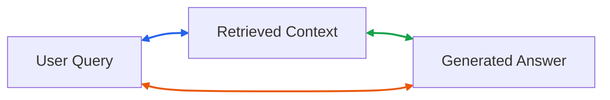

# Day 85: RAG Evaluation with Ragas Framework & Semantic Response Caching

## 1. Architectural Overview

Production Retrieval-Augmented Generation (RAG) systems cannot be treated as black-box probabilistic text generators. To achieve enterprise reliability (financial analysis, medical diagnostics, legal compliance, and SLA-bound customer support), engineers require **deterministic evaluation metrics** and **high-efficiency semantic caching mechanisms**.

```mermaid
flowchart TD
    subgraph Client & Caching Layer
        UserQuery["Incoming User Query (Q)"] --> Tier1["Tier 1: Exact Hash Cache (SHA-256)"]
        Tier1 -- "Hit (O(1), <1ms)" --> ReturnCached["Return Cached Response"]
        Tier1 -- "Miss" --> Tier2["Tier 2: Semantic Vector Cache"]
        Tier2 -- "Similarity >= Threshold (e.g. 0.92)" --> ReturnCached
        Tier2 -- "Miss" --> RAGPipeline["Execute Full RAG Pipeline"]
    end

    subgraph RAG Pipeline
        RAGPipeline --> Retrieve["Retrieve Context Chunks (C)"]
        Retrieve --> Synthesize["LLM Synthesis (A)"]
        Synthesize --> CacheStore["Store in Tier 1 & Tier 2 Cache"]
        Synthesize --> UserResponse["Stream Response to User"]
    end

    subgraph Continuous Evaluation (Ragas Framework)
        UserQuery -.-> Evaluator["Ragas Evaluation Engine"]
        Retrieve -.-> Evaluator
        Synthesize -.-> Evaluator
        GroundTruth["Ground Truth (GT)"] -.-> Evaluator

        Evaluator --> Metric1["1. Faithfulness (Groundedness)"]
        Evaluator --> Metric2["2. Answer Relevance"]
        Evaluator --> Metric3["3. Context Precision"]
        Evaluator --> Metric4["4. Context Recall"]
    end
```

---

## 2. Theoretical Foundations: The RAG Triad

Traditional NLP metrics like **BLEU** and **ROUGE** measure surface n-gram overlap and fail completely when evaluating semantic accuracy, logical deductions, or factual grounding. The **RAG Triad** measures the three critical interaction boundaries of a RAG architecture:



### 2.1 Faithfulness (Groundedness)
Measures whether every factual claim made in the generated answer $A$ can be directly inferred from the retrieved context $C$. It detects **hallucinations**.

$$\text{Faithfulness} = \frac{|\text{Verified Claims in } A \text{ supported by } C|}{|\text{Total Claims in } A|}$$

- $\text{Score} = 1.0$: Completely grounded; zero hallucination.
- $\text{Score} < 1.0$: Hallucinated claims present.

### 2.2 Answer Relevance
Measures whether the generated answer $A$ directly addresses the user's query $Q$, penalizing answers that are verbose, evasive, or off-topic.

In Ragas, this is computed by prompting an evaluation model to reverse-generate $N$ potential questions $\{q_1, q_2, \dots, q_N\}$ from $A$, embedding them with an encoder $E(\cdot)$, and computing average cosine similarity to original query embedding $E(Q)$:

$$\text{Answer Relevance} = \frac{1}{N} \sum_{i=1}^N \frac{E(Q) \cdot E(q_i)}{\|E(Q)\| \|E(q_i)\|}$$

### 2.3 Context Precision (Signal-to-Noise Ratio)
Measures whether the most relevant context chunks are ranked at the top of the retrieved set. It penalizes "distractor" chunks ranked ahead of useful chunks.

Given retrieved chunks ordered by rank $k \in \{1, \dots, K\}$ where $\text{rel}(k) \in \{0, 1\}$ indicates relevance:

$$\text{Context Precision@K} = \frac{\sum_{k=1}^K \text{Precision@k} \times \text{rel}(k)}{\sum_{k=1}^K \text{rel}(k)}$$

where:
$$\text{Precision@k} = \frac{\sum_{i=1}^k \text{rel}(i)}{k}$$

### 2.4 Context Recall (Coverage)
Measures whether all ground-truth facts required to answer the query are captured across the retrieved chunks $C$:

$$\text{Context Recall} = \frac{|\text{Ground Truth Sentences supported by } C|}{|\text{Total Sentences in Ground Truth}|}$$

---

## 3. Two-Tier Semantic Response Caching Architecture

LLM inference calls introduce high monetary costs (\$0.01 - \$0.05 per call) and high latency (400ms - 3500ms). Semantic response caching reduces p95 latency to $<2\text{ms}$ and cuts token expenses by 30%–70% for enterprise workloads.

| Dimension | Tier 1: Exact Hash Cache | Tier 2: Vector Semantic Cache |
| :--- | :--- | :--- |
| **Lookup Mechanism** | SHA-256 of canonicalized query | Vector cosine similarity index (HNSW / Flat) |
| **Lookup Latency** | $\mathcal{O}(1)$ hash table (~$0.05\text{ms}$) | $\mathcal{O}(\log N)$ or $\mathcal{O}(N)$ vector scan (~$1.5\text{ms}$) |
| **Hit Criteria** | Exact string match after normalization | $\cos(E(Q_{\text{new}}), E(Q_{\text{cached}})) \ge \tau$ (e.g., $0.92$) |
| **Memory Footprint** | Extremely low (~64 bytes/entry) | Moderate (Embedding vectors + metadata) |
| **Handling Paraphrasing** | Fails on slight wording changes | Succeeds across synonymous queries |
| **Eviction Policy** | TTL + LRU | TTL + LRU + Namespace/Document Invalidation |

### The Similarity Threshold ($\tau$) Dilemma
- If $\tau \ge 0.95$: Low recall; cache misses frequent paraphrases.
- If $\tau \le 0.85$: High recall, but high false-positive rate (semantic drift), serving incorrect answers to subtly distinct questions (e.g., "How do I reset password in dev?" vs "How do I reset password in prod?").
- **Production Standard**: $\tau \in [0.90, 0.93]$ with strict metadata filtering (environment, user role, tenant ID).

---

## 4. Production Engineering Best Practices

1. **Prompt Canonicalization**: Before hashing or embedding, strip trailing whitespace, lower-case tokens, remove extraneous punctuation, and sort system prompt headers.
2. **Deterministic Judge Models**: In LLM-as-a-judge pipelines, always set `temperature=0.0` and utilize JSON-schema output validation to ensure invariant evaluation scores.
3. **Cache Stampede Prevention**: When a popular cached key expires, use distributed locks or probabilistic early expiration (XFetch algorithm) to prevent hundreds of simultaneous LLM calls.
4. **Namespace Isolation**: Segment semantic caches by user permissions, organization ID, and document version timestamps to prevent cross-tenant data leakage.
