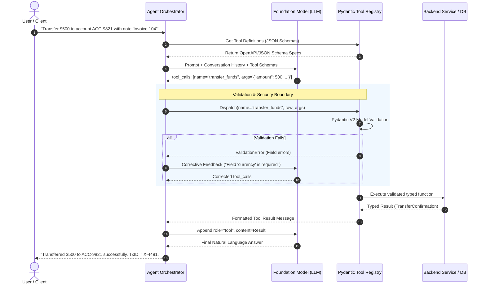

# Day 86: LLM Tool Calling & Function Execution with Strict Pydantic Contracts

## 1. Architectural Overview

Large Language Models (LLMs) are fundamentally isolated reasoning engines without native access to dynamic databases, internal microservices, real-time web APIs, or operational filesystems. **Tool Calling** (Function Calling) transforms an LLM from a passive text synthesizer into an active, deterministic agent capable of orchestrating complex backend workflows.



---

## 2. Core Mechanics: From Pydantic V2 to JSON Schema

Modern LLM function calling requires adhering to the **JSON Schema Draft 7 / Draft 2020-12** specification. Foundation models (OpenAI GPT-4o, Anthropic Claude 3.5, Google Gemini 1.5) are fine-tuned to emit valid JSON objects whose keys and value types match the schema provided in the request payload.

### Schema Generation Mechanics
In Python, **Pydantic V2** provides automatic, high-performance schema serialization via `BaseModel.model_json_schema()`:

```python
from pydantic import BaseModel, Field
from typing import Literal

class DatabaseQuerySchema(BaseModel):
    """Executes a strictly read-only SQL query against the analytics replica."""
    table_name: Literal["orders", "customers", "inventory"] = Field(
        ..., description="Target database table to inspect"
    )
    limit: int = Field(
        default=10, ge=1, le=100, description="Maximum number of rows to retrieve"
    )
    filter_column: str = Field(
        ..., description="Column name for filtering conditions"
    )
```

The emitted JSON Schema includes field types, validation constraints (`ge=1`, `le=100`), enum literals, and docstrings:

```json
{
  "type": "function",
  "function": {
    "name": "DatabaseQuerySchema",
    "description": "Executes a strictly read-only SQL query against the analytics replica.",
    "parameters": {
      "type": "object",
      "properties": {
        "table_name": {
          "type": "string",
          "enum": ["orders", "customers", "inventory"],
          "description": "Target database table to inspect"
        },
        "limit": {
          "type": "integer",
          "default": 10,
          "minimum": 1,
          "maximum": 100,
          "description": "Maximum number of rows to retrieve"
        },
        "filter_column": {
          "type": "string",
          "description": "Column name for filtering conditions"
        }
      },
      "required": ["table_name", "filter_column"]
    }
  }
}
```

---

## 3. The Self-Healing Validation Boundary

LLMs are probabilistic. Even with constrained decoding, an LLM may:
1. Omit required parameters.
2. Pass string floats instead of integers (`"10"` vs `10`).
3. Hallucinate non-existent arguments.
4. Pass invalid enum options.

### The Self-Healing Protocol
Instead of crashing or aborting the agent execution upon encountering invalid tool arguments, enterprise systems catch `pydantic.ValidationError`, extract the specific field errors, and append them as a corrective feedback message to the LLM:

$$\text{Feedback} = \text{FormatErrors}(\text{ValidationError.errors()})$$

The LLM inspects the exact schema violation and regenerates the tool call arguments with correct typing on the subsequent turn.

---

## 4. Enterprise Security & Hardening Boundaries

| Security Domain | Vulnerability / Attack Vector | Engineering Defense |
| :--- | :--- | :--- |
| **Arbitrary Code Execution** | Prompt injection tricks LLM into passing `__import__('os').system('rm -rf')` to an execution tool. | Never expose raw `eval()` or unsanitized shell tools. Only invoke pre-compiled Python functions with strict Pydantic schemas. |
| **SQL Injection** | LLM passes raw SQL string `SELECT * FROM users WHERE id = '1' OR '1'='1'`. | Use structured query builders or parameterized queries. Validate table names against explicit Enum/Literal allowlists. |
| **Cross-Tenant Privilege Escalation** | LLM sets `tenant_id` or `user_id` argument to target another enterprise customer. | Never allow the LLM to supply tenant or authorization IDs. Bind them automatically from verified session JWT claims. |
| **Output Token Exhaustion** | A database tool returns 200,000 rows (50MB of JSON), exceeding LLM context window limits. | Enforce hard truncation, pagination, and summarization at the tool execution boundary before passing results to the LLM. |
| **Infinite Tool Loops** | Model enters a cycle calling the same failing tool repeatedly. | Enforce a strict maximum iteration counter (e.g., `max_turns=5`) and circuit breakers. |
