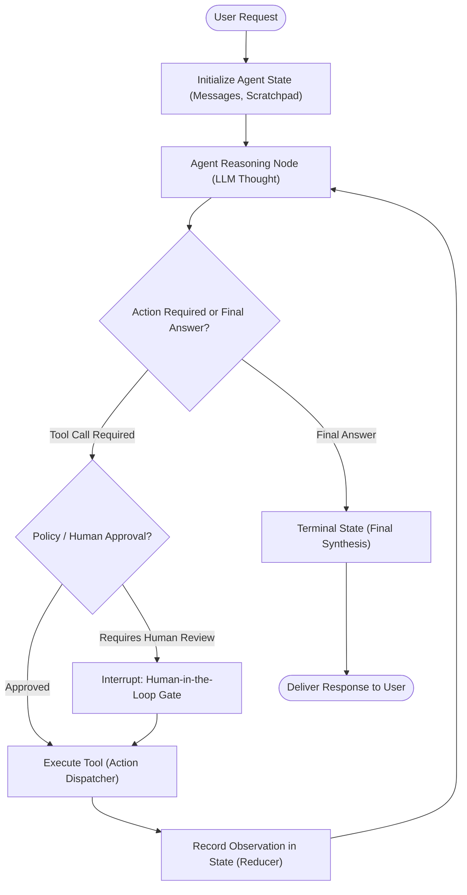
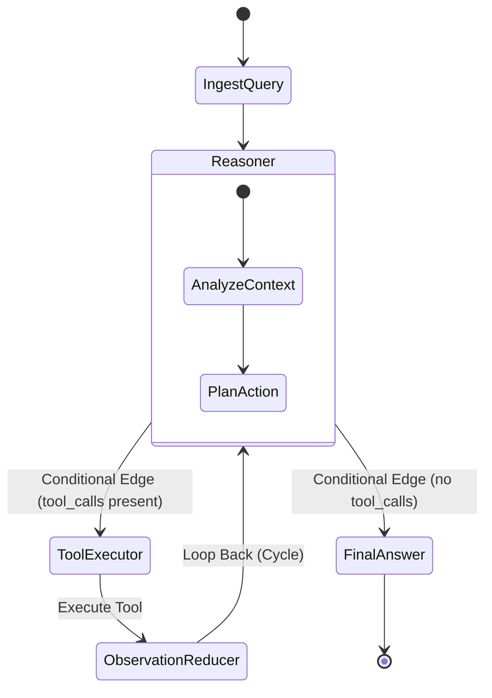
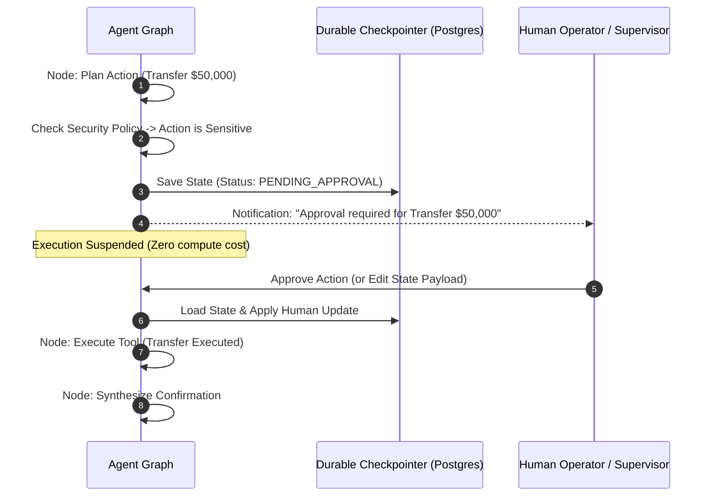

# Day 87: AI Agents — ReAct Architecture, State Machines & LangGraph Workflows

## 1. Architectural Overview

While basic Retrieval-Augmented Generation (RAG) and single-step Tool Calling operate as deterministic request-response pipelines, **Autonomous AI Agents** introduce **iterative reasoning, dynamic stateful persistence, and multi-step decision loops**. 

An agent perceives an objective, formulates a reasoning hypothesis, selects and executes actions (tools), observes the environmental feedback, and iteratively adapts its plan until the terminal state is reached or human intervention is requested.

---

## 2. The ReAct Architecture (Reasoning + Acting)

Formulated by Yao et al. (2022), **ReAct** intertwines chain-of-thought reasoning with execution actions:
1. **Thought**: The model generates a natural-language decomposition of the current state, deducing what missing information is required.
2. **Action**: The model emits a structured tool call to query an external environment (database, web search, calculator, API).
3. **Observation**: The external environment returns the execution result, which is appended to the agent's context.

Without reasoning traces, models suffer from blind trial-and-error (action-only). Without actions, models suffer from hallucinations and knowledge cutoff limits (reasoning-only). ReAct bridges this gap by grounding reasoning traces in verifiable real-time observations.

---

## 3. Agentic State Machines & Cyclic Computation Graphs

Standard workflow engines (Airflow, Prefect, Celery) are strictly **Directed Acyclic Graphs (DAGs)**. Autonomous agents, however, are fundamentally **cyclic**: an agent must loop back, retry failed actions, reflect on errors, and reconsider strategies.

### The Three Primitives of Graph-Based Agent Workflows (LangGraph Pattern)
1. **State Schema**: A centralized, typed data structure (e.g., Pydantic or TypedDict) shared across all nodes. State updates are controlled via **Reducers** (e.g., `operator.add` for appending messages without overwriting history).
2. **Nodes**: Pure functions or coroutines representing compute units:
   $$\text{Node}: \text{State}_{t} \to \Delta \text{State}_{t+1}$$
3. **Edges & Conditional Edges**:
   - *Static Edges*: Fixed transitions between nodes (e.g., `ToolExecutor` $\to$ `ObservationReducer`).
   - *Conditional Edges*: Dynamic routing functions that inspect current state:
     $$\text{Router}(\text{State}) \to \text{NextNodeName}$$

---

## 4. State Persistence, Checkpointing & Human-in-the-Loop (HITL)

Enterprise agents executing financial transactions, production deployments, or sensitive data deletions cannot operate with unconstrained autonomy. They require **State Checkpointing** and **Human-in-the-Loop (HITL) Gates**.

### Checkpointing Mechanics
- After every node execution, the orchestrator serializes the state to a durable store (PostgreSQL / Redis) keyed by `(thread_id, checkpoint_id)`.
- If a node crashes or the process is restarted, the agent resumes execution from the exact checkpoint without re-running prior expensive LLM calls.

### Human-in-the-Loop Approval Pattern

---

## 5. Architectural Comparison: Single-Prompt vs ReAct vs Graph State Machine

| Dimension | Single-Prompt LLM | Simple ReAct Loop | Graph-Based State Machine (LangGraph) |
| :--- | :--- | :--- | :--- |
| **Control Flow** | Linear (1 turn) | While-loop with fixed prompt | Cyclic state machine with explicit branches |
| **State Management** | Ephemeral | In-memory message list | Schema-validated state with persistent checkpoints |
| **Branching & Loops** | None | Implicit via LLM stop tokens | Explicit conditional edges & multi-agent routing |
| **Failure Recovery** | Fails completely | Primitive retry counter | Rollback to checkpoint, self-correction nodes |
| **Human Approval** | Not possible | Blocking sleep / polling | Native async interrupt & state injection |
| **Production Fit** | Simple Q&A | Small deterministic tasks | Complex enterprise workflows, multi-agent teams |
