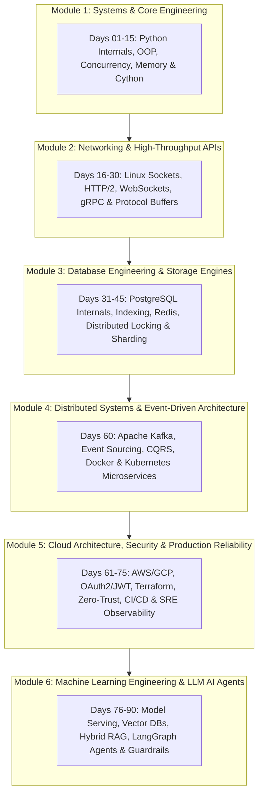
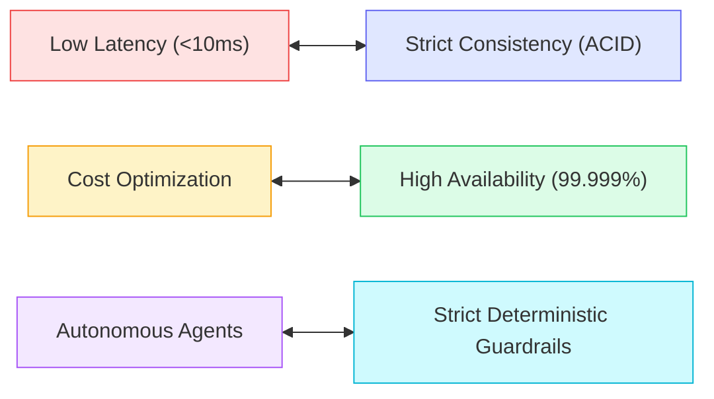

# Day 90: Master Technical Interview Marathon (500+ Q&As) & Portfolio Polish

## 1. The 90-Day Journey: Full-Stack Curriculum Synthesis

**Day 90** marks the triumphant completion of the comprehensive **90-Day Backend & Machine Learning Engineering Curriculum**. Over the course of 90 rigorous, production-grade days, this repository has systematically constructed an enterprise engineering foundation spanning low-level system internals, high-throughput distributed architectures, and cutting-edge Generative AI agent platforms.

---

## 2. Master Competency Taxonomy

A Staff / Principal Backend & AI Engineer must navigate fluidly between low-level memory allocations and multi-region distributed agent graphs:

| Engineering Domain | Foundational Concepts Mastered | Production Capstone Deliverables |
| :--- | :--- | :--- |
| **Python Internals & Concurrency** | GIL mechanics, garbage collection (Generational + RefCount), asyncio event loops, multiprocessing, zero-copy buffers. | Async worker engines, custom memory allocators. |
| **Networking & Protocols** | TCP handshakes, TLS termination, HTTP/1.1 vs HTTP/2 vs HTTP/3, binary gRPC streaming, multiplexing. | Low-latency streaming gateways, gRPC microservices. |
| **Databases & Storage Engines** | B-Trees, LSM trees (RocksDB), MVCC in PostgreSQL, write-ahead logs (WAL), Redis memory eviction (LRU/LFU). | Sharded multi-tenant DB schemas, read-replica clusters. |
| **Distributed Systems** | CAP theorem, PACELC, Raft consensus, Kafka partition assignment, idempotent message consumers, two-phase commits. | Event-driven order processing pipelines, outbox patterns. |
| **Cloud & Site Reliability** | Docker multi-stage builds, Kubernetes Ingress/HPA, Terraform IaC, rate limiting, circuit breakers, OpenTelemetry. | Production Docker Compose topologies, auto-scaling clusters. |
| **ML & AI Engineering** | Embedding vector spaces, pgvector HNSW indexing, BM25, Reciprocal Rank Fusion, ReAct agents, LangGraph state machines, guardrails. | Enterprise Multimodal RAG with Autonomous Multi-Agent Teams. |

---

## 3. The 90-Day Production Portfolio Assets

Across the curriculum, 4 comprehensive capstone projects have been engineered from first principles:

1. **Capstone 1 (Day 30)**: Ultra-High Throughput Async Microservice Gateway (FastAPI, Redis, gRPC).
2. **Capstone 2 (Day 45)**: Distributed Multi-Tenant Financial Ledger with ACID Guarantees & Distributed Locks.
3. **Capstone 3 (Day 60)**: Event-Driven Real-Time Analytics Pipeline with Apache Kafka, Debezium CDC & TimescaleDB.
4. **Capstone 4 (Day 89)**: Enterprise Multimodal RAG Platform & Autonomous Multi-Agent LangGraph Backend.

---

## 4. The Staff Engineer Mindset: Technical Tradeoff Matrix

Senior technical interviews do not test rote memorization; they evaluate **tradeoff navigation under non-ideal constraints**:

1. **Consistency vs Latency**: In financial transactions, trade latency for strict serializability; in semantic response caching, trade strict immediate consistency for sub-millisecond retrieval.
2. **Heuristic vs Heavy Guardrails**: Fast regex/token classifiers for sub-5ms pre-flight filtering; LLM-as-a-judge reserved strictly for asynchronous post-generation audits.
3. **Cyclic vs DAG State Machines**: Use cyclic state graphs when reasoning reflection and self-healing retries are necessary; use DAG pipelines when tasks are deterministic and statically ordered.
